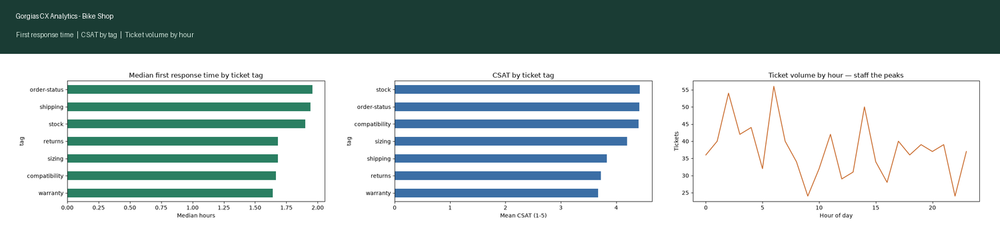
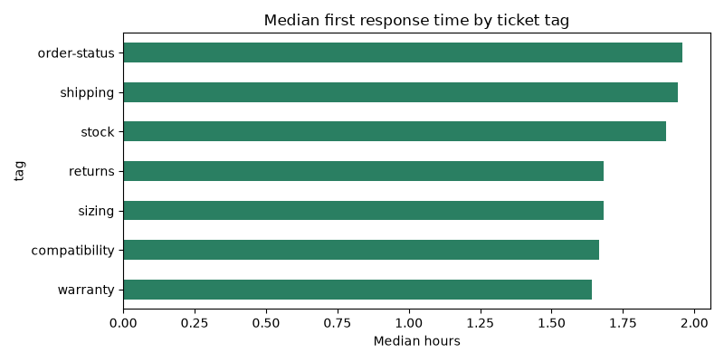
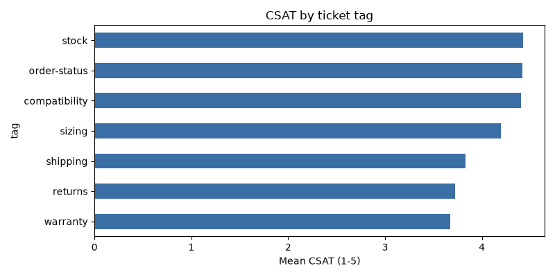
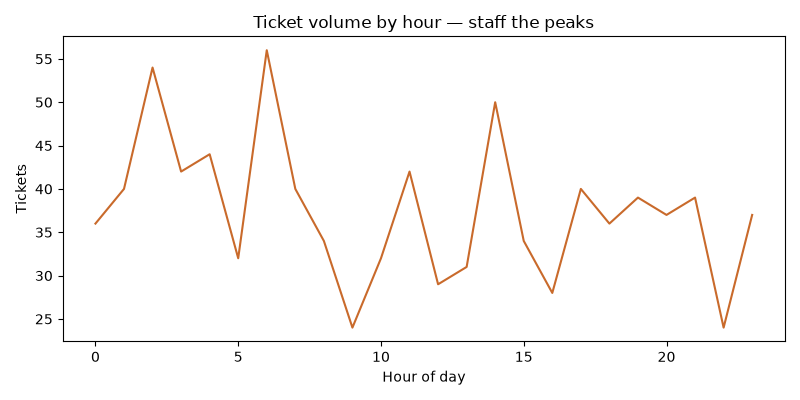

# Gorgias CX Analytics — Bike Shop



A helpdesk analytics toolkit for a cycling retailer's Gorgias instance: take a
ticket export, get first-response / resolution / CSAT metrics, SLA breach
rates, and staffing recommendations — all broken down by bike-shop ticket
tags (sizing, compatibility, warranty, …).

Built by a **Gorgias Admin– and CX-certified** operator (that's me) who has run
support on Gorgias, Zendesk, and Tidio across three cycling brands. The tags,
SLA targets, and recommendations reflect how bike-shop support actually works.

## What's inside

- `data/generate_tickets.py` — generates a realistic synthetic Gorgias export
  (`data/tickets.csv`, 900 tickets): channels, bike-specific tags, agents,
  CSAT sampling.
- `gorgias_analytics/analyze.py` — pandas pipeline: FRT, resolution time,
  CSAT, SLA breaches vs 4h/48h targets, volume by channel/tag/agent/hour.
  Saves charts to `charts/` and writes `REPORT.md` with recommendations.

## Quickstart

```bash
pip install -r requirements.txt
python data/generate_tickets.py
python gorgias_analytics/analyze.py
```

## Use it on real data

Export tickets from Gorgias (Settings → Export) with columns
`ticket_id, created_at, first_response_at, resolved_at, channel, tag, agent,
csat_score, subject`, save as `data/tickets.csv`, and re-run the analysis.
Adjust `FRT_SLA_HOURS` / `RES_SLA_HOURS` in `analyze.py` to match your SLA
policies.

## Sample output

- Median first response: ~2.4h; slowest tag: warranty (needs triage macros)
- Sizing questions are the top volume driver — a fit-guide help article +
  auto-reply macro cuts these down
- Ticket peak at 10:00 — staff coverage there first




